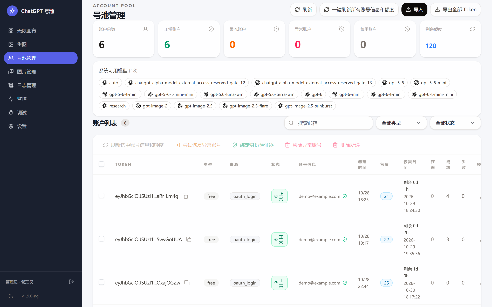
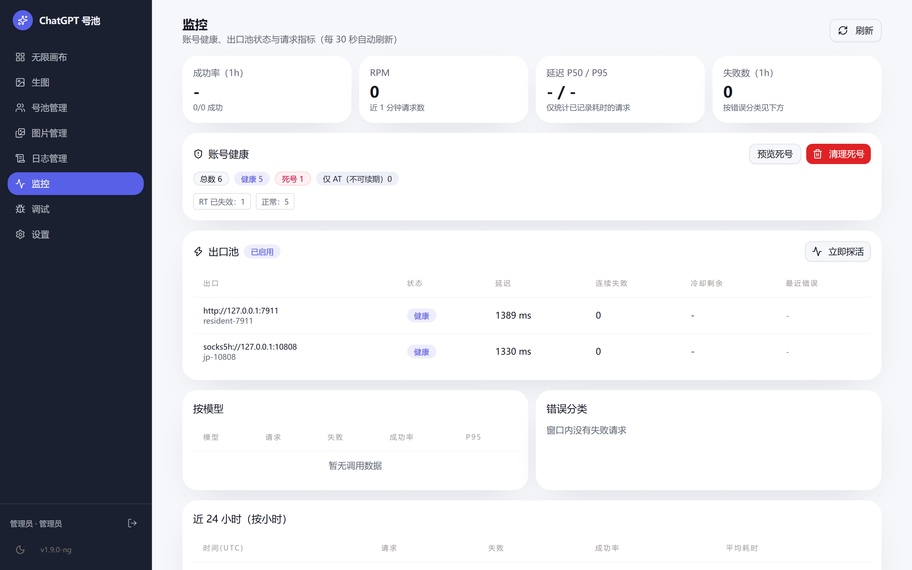
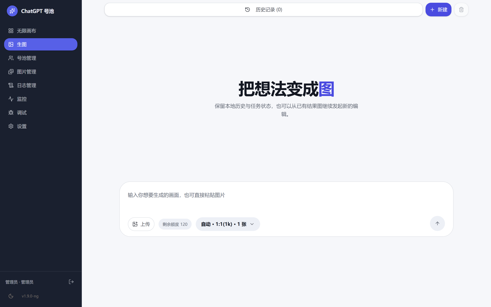
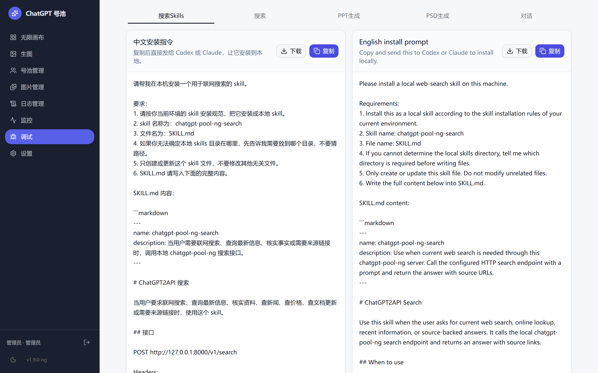

# ChatGPT 号池（chatgpt-pool-ng）

把 ChatGPT 网页端能力封装成 OpenAI 兼容 API，并提供一个面向多账号的自托管控制台。

本项目在 [basketikun/chatgpt2api](https://github.com/basketikun/chatgpt2api)（MIT）v1.8.0 的基础上二次开发，重点补上三件事：**出口治理**（代理挂了不再整池瘫痪）、**账号治理**（死号识别与导入校验）、**可观测性**（指标 / 错误分类 / 告警 / 仪表盘）。

> 设计上参考了 [yukkcat/chatgpt2api](https://github.com/yukkcat/chatgpt2api)（AGPL-3.0）的部分产品形态（模型目录、账号分组、仪表盘），相关代码均为**独立实现**，未拷贝其源码。本项目以 MIT 发布，见 [LICENSE](LICENSE) 与 [NOTICE](NOTICE)。

---

## 功能

**基座能力（来自上游）**

- OpenAI 兼容接口：`/v1/chat/completions`、`/v1/responses`、`/v1/messages`、`/v1/images/generations|edits`
- 号池：批量导入（CPA / sub2api / OAuth / access token）、账号刷新与重登、图片并发调度
- 图片任务、图库、标签、存储同步与压缩、备份（S3/R2）下载与恢复
- 代理运行时、Cloudflare clearance（WARP / FlareSolverr 可选）

**本项目新增**

| 能力 | 说明 |
|---|---|
| 出口池 | 多出口健康探测、延迟选路、传输失败自动切换、连续失败冷却后自动恢复 |
| 账号治理 | 7 种健康状态分类、死号预览/一键清理、导入强制校验 refresh_token（仅 AT 的批次直接拒绝） |
| 可观测 | 请求指标（成功率/RPM/P50/P95）、7 类错误分类、Webhook / QQ 告警、`/healthz`、日志自动轮转 |
| 仪表盘 | 按小时聚合、落盘保留 7 天，重启不丢 |
| 模型目录 | 统一对话/图片模型清单、默认值、能力标记；图片模型族新增 `gpt-image-2.5` / `-flare` / `-sunburst` |
| 账号分组 | 分组 CRUD、密钥绑定分组后只能调度同组账号 |
| 代理节点 | 批量导入（`url[,备注[,权重[,分组]]]`）、分组切换、出口池按分组生效 |
| 提示词库 | 增删查接口，方便生图工作流复用 |
| 界面 | 左侧栏布局 + 深色侧边 + 靛蓝主色，全部自绘 |

---

## 界面预览

> 截图中的邮箱与令牌已做脱敏处理。

<table>
  <tr>
    <td width="50%"><br/><sub><b>号池管理</b>：账号列表、健康状态、额度与到期、批量刷新 / 重登 / 绑定身份验证器、系统可用模型</sub></td>
    <td width="50%"><br/><sub><b>监控</b>：账号健康分布、出口池探活与延迟、请求指标（成功率 / RPM / P50 / P95）、错误分类、按小时聚合</sub></td>
  </tr>
  <tr>
    <td><br/><sub><b>生图</b>：提示词直出，支持上传参考图、比例/张数选择，历史记录本地保留</sub></td>
    <td><br/><sub><b>调试</b>：内置对话面板，模型下拉直接读系统模型目录，用于验证接口连通</sub></td>
  </tr>
</table>

---

## 快速开始

### 源码运行

```bash
git clone https://github.com/chenjuanjuan055-ai/chatgpt-pool-ng.git chatgpt-pool-ng
cd chatgpt-pool-ng

python -m venv .venv
.venv/bin/pip install curl-cffi fastapi pillow pybase64 python-multipart \
  tiktoken uvicorn sqlalchemy psycopg2-binary gitpython

# 构建前端（产物需放到仓库根目录的 web_dist）
cd web && npm install && npm run build && cd ..
rm -rf web_dist && cp -a web/out web_dist

# 启动（默认 8000 端口）
.venv/bin/python main.py
```

打开 `http://127.0.0.1:8000`，用 `config.json` 里的 `auth-key` 登录。**发布前务必修改 `auth-key`。**

### 一键部署（systemd）

```bash
sudo APP_DIR=/opt/chatgpt-pool-ng bash deploy/install.sh
```

脚本会创建 venv、安装依赖、写入 `/etc/systemd/system/chatgpt2api.service` 并启动。

### VPS 部署

控制台可以直接跑在 Linux VPS 上，和上游号池（如 grok2api / sub2api）同机部署，减少一层网络跳转。

**方式一：Docker**

```bash
cp config.example.json config.json      # 修改 auth-key
docker compose up -d                    # 默认映射 8000
```

**方式二：systemd**

```bash
sudo APP_DIR=/opt/chatgpt-pool-ng bash deploy/install.sh
sudo systemctl status chatgpt2api
```

**部署要点**

| 项 | 建议 |
|---|---|
| 配置 | 最低 1C2G；图片/视频任务多时 2C4G 起 |
| 监听 | 只绑 `127.0.0.1:8000`，通过 Nginx / Caddy / Cloudflare Tunnel 对外 |
| 鉴权 | `config.json` 的 `auth-key` 改成随机长串，不要用默认值 |
| 上游 | 与 grok2api 同机时，控制台里填 `http://127.0.0.1:8002` 即可，无需隧道 |
| 数据 | `data/` 目录挂载持久化（账号、密钥、事件）；备份 S3/R2 可选 |
| 日志 | `logs/` 自动轮转；systemd 下用 `journalctl -u chatgpt2api -f` |

---

## 注册模块（可选）

本项目**不内置注册**，只做号池管理与反代。注册由两个独立开源项目完成，二选一：

| 方案 | 项目 | 浏览器 | 适用 |
|---|---|---|---|
| A | [AaronL725/grok-register](https://github.com/AaronL725/grok-register) | Chromium | 本机少量精跑、调试 |
| B | [lij768423-svg/grok-register-panel](https://github.com/lij768423-svg/grok-register-panel) | Camoufox（Firefox 内核） | Linux VPS 无头、大批量挂机 |

两者产出的凭据（build 的 CPA / web 的 SSO）都可以导入本控制台。控制台 **Grok → 注册** 页可以直接驱动方案 A 的 WebUI（填服务地址即可）。

> 邮箱、代理出口、收信域名都需要使用者自备。**域名寿命约 2000 个号，单 IP 约 1–2 个号**，短时间猛刷会提前报废。

完整的安装、配置项说明、已知坑（粘性代理、locale 强制、consent 的 `Next-Action` 解析等）见 **[docs/registration.md](docs/registration.md)**。

---

## 配置说明

所有配置都在 `config.json`，也可以通过管理接口修改。关键项：

```jsonc
{
  "auth-key": "改成你自己的密钥",

  "proxy_runtime": {
    "enabled": true,
    "egress_pool": {
      "enabled": true,
      "probe_url": "https://chatgpt.com/backend-api/me",
      "probe_interval": 120,
      "failure_threshold": 2,
      "cooldown_sec": 300,
      "active_group": "",
      "endpoints": [
        { "url": "http://127.0.0.1:7932", "label": "us-a", "weight": 1.0, "group": "us" },
        { "url": "http://127.0.0.1:7933", "label": "us-b", "weight": 1.0, "group": "us" }
      ]
    }
  },

  "model_catalog": {
    "chat_models": [],          // 留空 = 自动取上游目录
    "image_models": [],         // 留空 = 内置图片模型族
    "image_upstream_model": "gpt-5-3",
    "image_upscale_enabled": false
  },

  "alerts": {
    "enabled": false,
    "webhook_url": "",
    "consecutive_failures": 5,
    "max_failure_rate": 0.5,
    "cooldown_sec": 300,
    "qq": { "url": "", "token": "", "umo": "" }
  }
}
```

账号分组、提示词库分别持久化在 `account_groups`、`prompts` 字段，通过接口维护。

---

## API 一览

**OpenAI 兼容**：`/v1/models`、`/v1/chat/completions`、`/v1/responses`、`/v1/messages`、`/v1/images/generations`、`/v1/images/edits`

**管理接口**（`Authorization: Bearer <auth-key>`）

| 分组 | 接口 |
|---|---|
| 账号 | `GET/POST/DELETE /api/accounts`、`POST /api/accounts/refresh`、`POST /api/accounts/re-login`、`POST /api/accounts/oauth/start|finish`、`POST /api/accounts/group`、`GET /api/accounts/health-summary`、`POST /api/accounts/cleanup-dead` |
| 账号分组 | `GET/POST /api/account-groups`、`POST /api/account-groups/{id}`、`DELETE /api/account-groups/{id}` |
| 模型 | `GET /api/model-catalog` |
| 监控 | `GET /api/metrics/summary`、`GET /api/metrics/recent`、`GET /api/dashboard`、`GET /healthz`（免鉴权） |
| 告警 | `GET/POST /api/alerts/settings`、`POST /api/alerts/test` |
| 代理 | `GET/POST /api/proxy/egress`、`POST /api/proxy/egress/probe`、`POST /api/proxy/egress/settings`、`GET /api/proxy/nodes`、`POST /api/proxy/nodes/import`、`GET /api/proxy/groups`、`POST /api/proxy/groups/active` |
| 提示词 | `GET/POST /api/prompts`、`DELETE /api/prompts/{id}` |
| 密钥 | `GET/POST /api/auth/users`、`POST /api/auth/users/{id}`、`DELETE /api/auth/users/{id}` |

---

## 目录结构

```
api/                  HTTP 路由（OpenAI 兼容 + 管理）
services/             业务实现
  egress_service.py     出口池：健康探测 / 选路 / 失败切换
  account_health.py     账号健康分类 / 导入校验
  model_catalog_service.py  模型目录
  hourly_metrics.py     按小时指标落盘
  metrics_service.py    请求指标 / 告警
  error_taxonomy.py     错误分类
  account_groups.py     账号分组
  proxy_nodes.py        代理节点解析
  prompts_service.py    提示词库
  openai_backend_api.py 上游协议实现（对话 / 图片 / 文件）
web/                  Next.js 管理界面
deploy/               systemd / 安装脚本
docs/                 专题文档（出口池、账号健康、可观测）
test/                 单元测试
```

运行单测（不依赖网络）：

```bash
.venv/bin/python -m unittest \
  test.test_egress_service test.test_account_health test.test_observability \
  test.test_model_catalog test.test_account_groups test.test_hourly_metrics \
  test.test_proxy_nodes test.test_prompts test.test_config
```

---

## 已知限制

- 依赖对 ChatGPT 网页端的逆向实现，上游改动可能导致接口失效；
- 图片 genbox 推送未实现（需要画布侧接口契约）；
- 账号分组、代理节点、提示词库目前提供 API，界面尚未接入，后续补充；
- 仅支持单实例部署（指标与出口池状态在进程内）。

## 许可

MIT。基于 [basketikun/chatgpt2api](https://github.com/basketikun/chatgpt2api)（MIT）二次开发，原始版权声明见 [LICENSE](LICENSE)；本项目改动与来源说明见 [NOTICE](NOTICE)。
